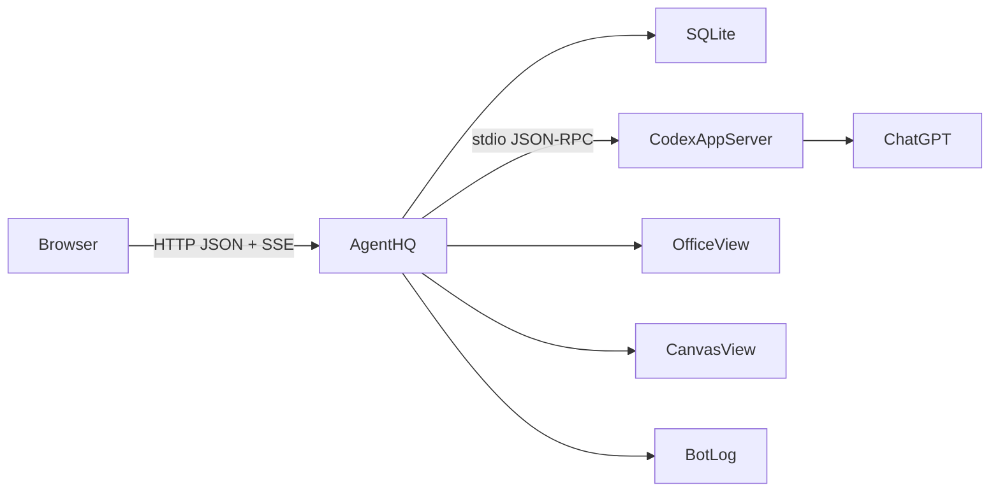

# AGENTS HQ Architecture

## Principle

**The office is the body. Codex is the brain. AGENTS HQ is the management system.**

Cosmetic animation never starts Codex turns. Execution state is owned by the Python backend and pushed to every view over SSE.

## Stack

- **Backend:** Python 3 stdlib `ThreadingHTTPServer` bound to `127.0.0.1:4181`
- **Persistence:** SQLite (`data/agent_hq.db`) with versioned SQL migrations
- **Realtime:** Server-Sent Events at `GET /api/events`
- **Frontend:** Vanilla JS modules under `static/js/` (no React/Electron)
- **Execution:** Codex App Server child process, newline-delimited JSON-RPC over stdio

## Backend modules

| Module | Role |
|---|---|
| `agent_hq.app` | HTTP API, static files, SSE, `AgentHQ` wiring |
| `agent_hq.db` | SQLite access, migrations |
| `agent_hq.events` | Event bus + durable log rows |
| `agent_hq.agents` | Seven-agent registry, tasks, dependencies, presets |
| `agent_hq.threads` | One primary Codex thread per agent |
| `agent_hq.conversations` | Local presentation cache of messages |
| `agent_hq.execution` | Durable queue, concurrency, Run Everything |
| `agent_hq.scheduler` | Backend recurrence (UTC storage) |
| `agent_hq.approvals` | Human approval for Codex server requests |
| `agent_hq.outputs` | Verified artifacts only |
| `agent_hq.codex.adapter` | App-server lifecycle and protocol |
| `agent_hq.codex.rpc` | Framing (`LineFramer`) and `RpcError` |
| `agent_hq.codex.mock_server` | Test-only mock (labelled) |
| `agent_hq.security` | Host/origin gate, CSRF token, path policy, redaction |

## Frontend modules

| File | Role |
|---|---|
| `store.js` | Snapshot + SSE store |
| `board.js` | Canvas cards and wires |
| `office.js` | Isometric office (cosmetic) |
| `panel.js` | Agent workspace (5 tabs) |
| `log.js` | Bot Log + Command Center |
| `dialogs.js` | How to Use, Setup, Codex, presets |
| `app.js` | Header, view toggle, Run Everything |

## Data flow

## Storage keys

Browser cosmetic prefs use the `ahq-` prefix (`ahq-view`, `ahq-pos-v1`, `ahq-howto`, sound). Legacy `smm-*` keys are ignored.
